# Peptimania — Peptide & Medication Tracker

A privacy-first, offline-capable Progressive Web App (PWA) for tracking medications, peptides, and supplements. **All
data stays in your browser by default** — notifications are off unless you explicitly opt in, and the optional
notification relay is the only possible exception. Built with Next.js, React, Tailwind CSS, shadcn/ui, and Dexie
(IndexedDB).

## What It Does

Peptimania helps you manage your medication/peptide regimen with:

- **Medication Management** - Track peptides, injections, pills, liquids, supplements, and other medications with custom
  units (mg, mcg, IU, mL, pcs)
- **Reconstitution Tracking** - For peptides, calculate dose volumes from vial quantities and bacteriostatic water
  amounts with built-in syringe visual guidance
- **Inventory Management** - Track stock across multiple purchase lots with vial counts, content per vial, vendor info,
  COA links, order/delivery dates, pricing, and low-stock thresholds
- **Scheduling & Dosing** - Create flexible schedules (daily, weekly with specific days, or custom intervals) with
  reminders shown on the dashboard
- **Dose Logging** - Log doses from schedules or ad-hoc, with optional injection site tracking (presets + custom) and
  notes
- **Pharmacokinetic Modeling** - Interactive concentration charts using first-order elimination (single-compartment
  model) combining logged doses and scheduled doses to project future concentrations
- **Body Measurements** - Track weight, blood pressure (stored as systolic/diastolic pairs), and custom metrics with
  trend visualization
- **Data Control** - Full JSON export/import with schema versioning, automatic pre-migration backups, and secure local
  storage management

## Screenshots

### Dashboard & Scheduling

| Today's doses on the dashboard                        | Schedules — Today tab                                     |
|-------------------------------------------------------|-----------------------------------------------------------|
| 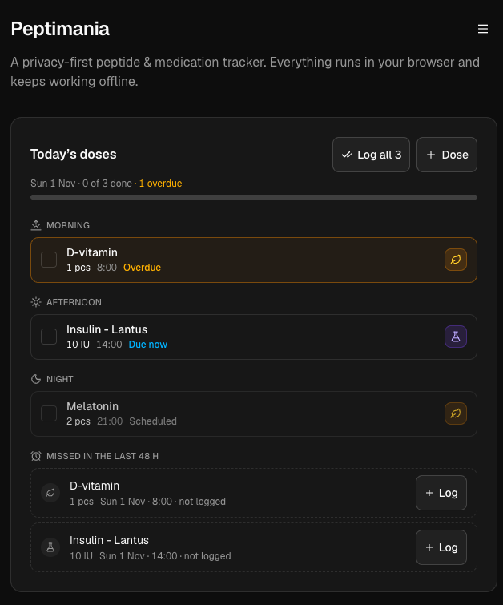 | 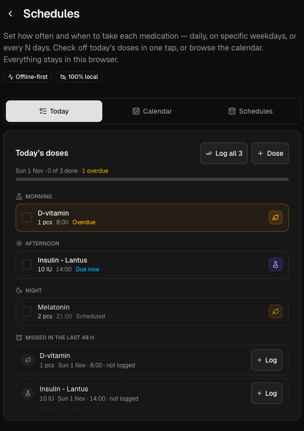 |
| **Schedules — Calendar view**                         | **Schedules — list & toggles**                            |
| 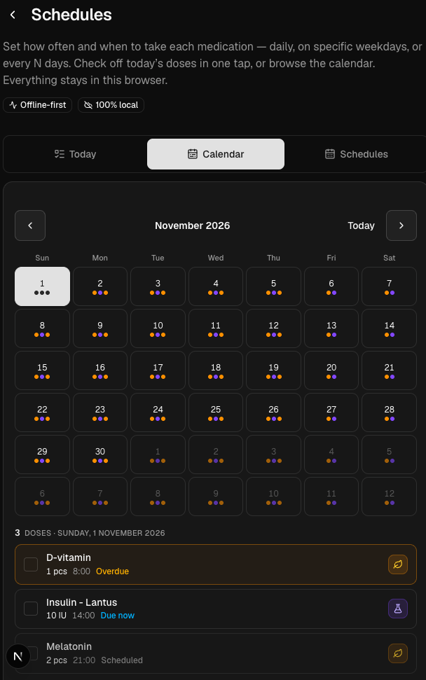 | 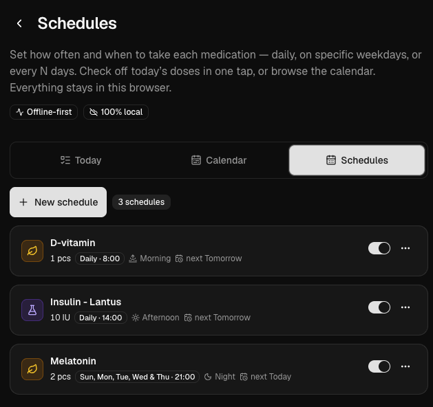             |

### Dose Log

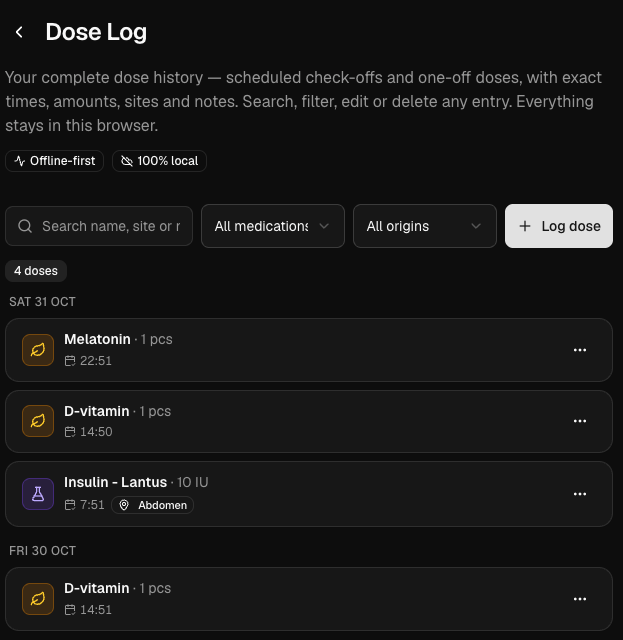

### Pharmacokinetic Concentration Chart

| Estimated concentration curve                     | Chart settings                                      |
|---------------------------------------------------|-----------------------------------------------------|
| 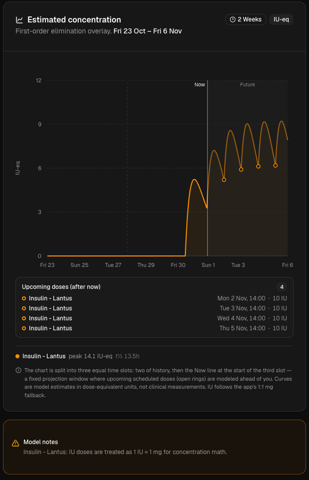 | 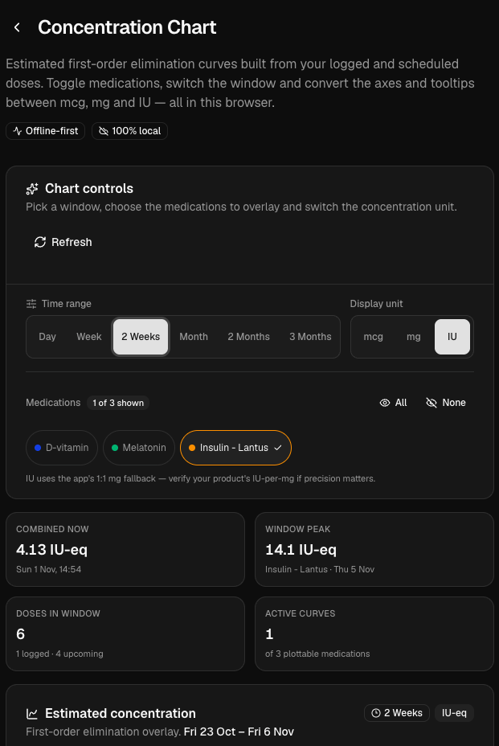 |

### Body Measurements

| Weight trend                              | Blood pressure                                                |
|-------------------------------------------|---------------------------------------------------------------|
| 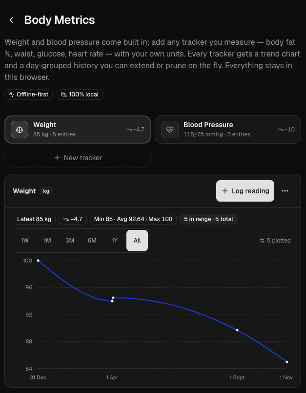 | 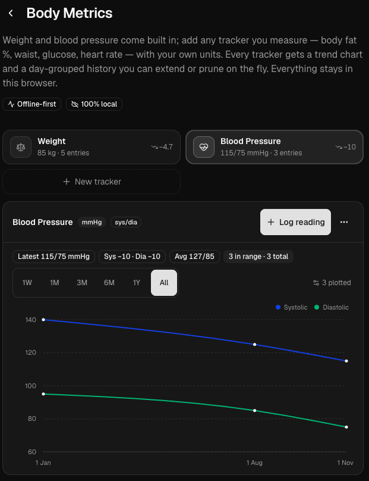      |
| **Waist circumference**                   | **Adding a custom tracker**                                   |
| 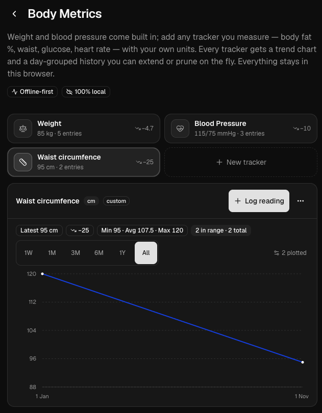   | 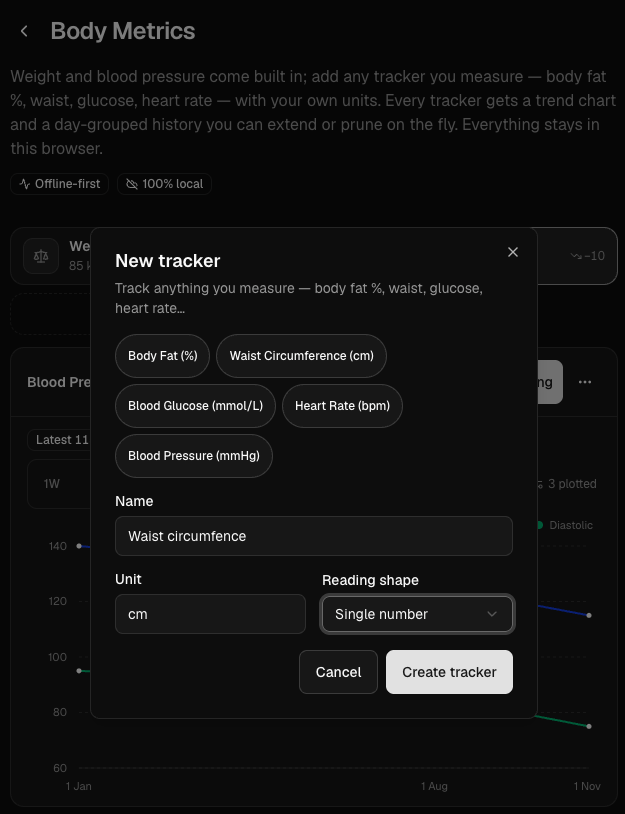 |

### Settings — Backup & Restore

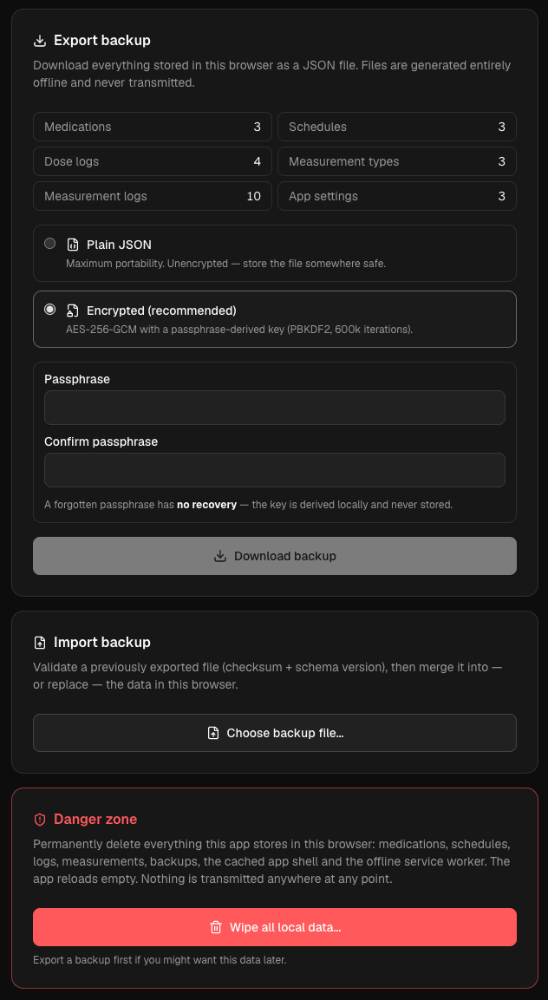

## How It Works

### Architecture

- **Frontend**: Next.js 16 (App Router, server build) with React 19, TypeScript
- **UI Components**: shadcn/ui built on Radix UI primitives with Tailwind CSS v4
- **Data Storage**: Dexie.js over IndexedDB for all application data, LocalStorage for preferences
- **Charts**: Recharts for pharmacokinetic curves and measurement trends
- **PWA**: Serwist service worker for offline functionality and caching
- **Forms**: React Hook Form with Zod validation
- **Optional relay**: a `/v1/*` Web Push relay in the same Next.js app, backed by a
  file-based SQLite database (`node:sqlite`) on a persistent volume, with VAPID keys kept
  server-side

### Privacy & Offline-First

- **Zero network dependencies for user data** - everything persists locally in your browser
- **Optional notifications** - dose reminders are off by default; enabling background delivery is the only feature that
  shares a minimal data set with a relay (see [docs/notifications-plan.md](docs/notifications-plan.md)). The relay runs
  in the same deployment, stores only push endpoints/timestamps in SQLite, and never receives medication names or doses
  unless you choose end-to-end encrypted detailed mode.
- **Fully offline capable** - works without internet after initial load
- **Installable PWA** - can be installed on desktop/mobile for app-like experience
- **Data sovereignty** - you control all data via export/import; no accounts or telemetry

### Schema & Migrations

The app uses a robust migration system to evolve without breaking existing data:

- Schema version tracked in `meta` store (currently v8)
- Sequential migrations with data transformations
- Automatic pre-migration backups before upgrades
- Snapshot migration support for imports from older versions
- Migrations are idempotent and safe to resume after crashes

Key schema evolution:

- **v1→v2**: Granular medication types, mL units, inventory container sizes
- **v2→v3**: Weekly schedule day selection, dose log occurrence matching (`scheduledFor`), local date normalization
- **v3→v4**: Optional injection site on dose logs
- **v4→v5**: Blood pressure measurement support with value kind tracking
- **v5→v6**: Inventory converted from single aggregate to multiple lots
- **v6→v7**: Lot pricing (`pricePerContainer` in USD)
- **v7→v8**: App settings store for UI preferences

### Pharmacokinetics

Concentration is calculated using the single-compartment first-order elimination model:

- Formula: `C(t) = Σ C_i * e^(-λ(t - t_i))` where `λ = ln(2)/t½`
- Combines past dose logs and future scheduled doses
- Supports time windows: 24h, 1W, 2W, 1M, 2M, 3M, 6M
- Toggleable multi-medication overlays
- Display units convertible between mcg/mg/IU

### Unit System

- **Mass**: mg, mcg, IU (with conversion utilities)
- **Volume**: mL (requires reconstitution context)
- **Count**: pcs (pills/capsules, no cross-unit conversion)
- All calculations normalize internally while preserving display preferences

## Getting Started

### Prerequisites

- Node.js >= 26.0.0
- A modern browser with IndexedDB support

### Development

```bash
npm install
npm run dev
```

Open [http://localhost:3000](http://localhost:3000) to see the app.

### Build & Production

```bash
npm run build  # Next.js server build + Serwist service worker
npm start      # next start (http://localhost:3000)
```

The app is a normal Next.js server build. It is still local-first; the server exists only
for the optional notification relay under `/v1/*`.

### Notification relay (optional)

Background reminders are disabled until the deployment provides VAPID keys:

```bash
npm run vapid:generate
```

Set `VAPID_PUBLIC_KEY`, `VAPID_PRIVATE_KEY` and `VAPID_SUBJECT` in the environment. The
SQLite file defaults to `.data/notifications.sqlite` locally and
`/data/notifications.sqlite` in Docker (set `NOTIFICATIONS_DB_PATH` to override). Without
keys the app still runs, but only on-device reminders are offered while the app is open.
See [.env.example](.env.example) and [docs/notifications-plan.md](docs/notifications-plan.md).

### Docker / Dokploy

```bash
docker build -t peptimania .
docker run -p 3000:3000 -v peptimania-data:/data \
  -e VAPID_PUBLIC_KEY=... -e VAPID_PRIVATE_KEY=... \
  -e VAPID_SUBJECT=mailto:you@example.com peptimania
```

On Dokploy, mount a persistent volume at `/data`, set the VAPID variables, expose port
`3000`, and use `GET /v1/health` as the health check. The app must be served over HTTPS for
Web Push (and for notifications in an installed iOS PWA).

### Project Structure

```
app/                    # Next.js App Router pages
├── page.tsx           # Dashboard with today's doses
├── medications/       # Medication CRUD & inventory
├── schedules/         # Schedule management
├── dose-logs/         # Dose history
├── notifications/     # Due/upcoming reminder centre
├── pharmacokinetics/  # Concentration charts
├── measurements/      # Body metrics tracking
├── settings/          # Data export/import, storage, app info
├── v1/[...path]/      # Optional Web Push relay API (server)
└── sw.ts              # Serwist service worker (push/click handlers)

components/            # React components (shadcn/ui based)
lib/
├── db/               # Database schema, migrations, Dexie setup
├── medications/      # Medication logic & utilities
├── pharmacokinetics/ # PK calculations
├── scheduling/       # Schedule/occurrence logic
├── measurements/     # Measurement handling
├── notifications/    # Consent, capabilities, relay client, encryption
├── server/           # Server-only relay config, SQLite, push, scheduler
└── settings/         # Settings management

docs/                # Design plans (notifications relay, client delivery)
scripts/             # VAPID key generation
public/               # Static assets, manifest, icons
```

## Key Features in Detail

- **Dashboard**: Quick view of today's scheduled doses with one-tap logging
- **Medication Details**: Reconstitution calculator, inventory lot management, pricing, COA links
- **Smart Scheduling**: Handles complex patterns with weekly day selection and custom intervals
- **Dose History**: Full log with filtering, editing, and injection site tracking
- **PK Charts**: Compare multiple medications, adjust time ranges, see projected vs actual concentrations
- **Measurements**: Numeric values or blood pressure pairs with trend graphs
- **Settings**: Storage usage, data export/import, theme preferences, app information

## Data Safety

- **Local-first**: All data in IndexedDB under the database name `peptimania`
- **Notification secrets**: relay credentials and the detailed-mode AES key live in the
  non-exported `peptimania-notifications` IndexedDB database and are erased by a wipe
- **Relay state (opt-in only)**: push endpoint/keys, reminder timestamps and content-free
  delivery status in the server's SQLite file; no dose history, inventory or measurements
- **Backups**: Pre-migration backups stored automatically before schema upgrades
- **Export/Import**: JSON format with schema version and checksum validation
- **Migration safety**: Sequential, resumable migrations with rollback protection
- **Storage monitoring**: Quota awareness with user-friendly messages

## License & Legal

See [TERMS.md](public/TERMS.md) for the full Terms of Service, Legal Disclaimer, and
licensing notice. In short:

- **First-run acceptance.** On first start (and every 30 days afterwards), the app shows
  these terms and requires an "I have read and agree" checkbox before you can continue.
  The acceptance time is stored locally as the `legal.termsAcceptedAt` setting — it is
  never transmitted anywhere.
- **No responsibility, no liability, no endorsement.** The app does not endorse or
  encourage peptide or medication use, provides no medical advice, and its calculations
  are approximations you verify yourself. The authors accept no liability of any kind
  for anything arising from use of the app.
- **"AS IS" / "AS AVAILABLE".** The software comes with absolutely no warranties.
- **No copyright — do whatever you want.** The software is free and dedicated to the
  public domain (with a permissive fallback where required by law): you may use, modify,
  distribute, and sell it without permission or attribution.

This is a personal health tracking tool. Use at your own discretion. Always consult
healthcare professionals for medical advice — this app is for tracking only, not medical
guidance.
